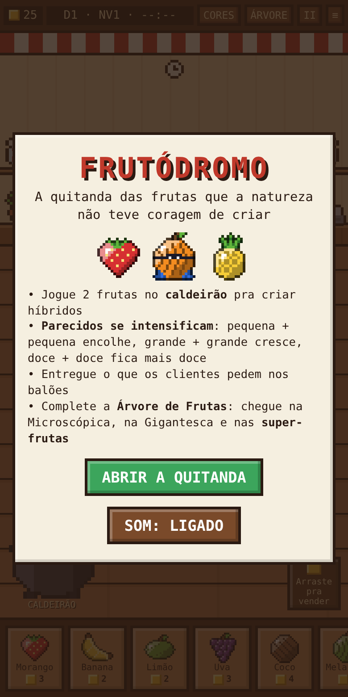
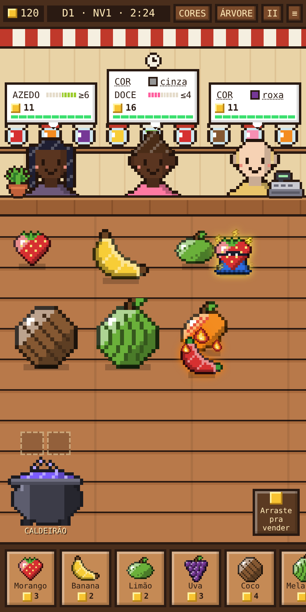
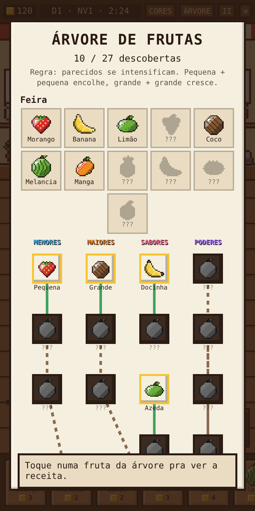

# 🍓 Frutódromo

**A quitanda das frutas que a natureza não teve coragem de criar.**

### 🎮 [Jogar agora → mendesoz.github.io/frutodromo](https://mendesoz.github.io/frutodromo/)

Frutódromo é um jogo de navegador em pixel art: você cruza frutas num caldeirão, cria híbridos com formato, cor e sabor herdados dos pais e atende os pedidos dos clientes que aparecem no balcão — gente, bichos, robôs, aliens e fantasminhas.

<p align="center">
  
  
  
</p>

## Como jogar

1. **Compre frutas** na feira (parte de baixo da tela).
2. **Jogue 2 frutas no caldeirão** para cruzar e criar um híbrido. O caldeirão pode ser arrastado pra qualquer lugar da mesa.
3. **Arraste a fruta até um cliente** que pediu algo parecido no balão.
4. Arraste para o canto da mesa para **vender**.
5. Ficou perdido? Toque no **?** do balão do cliente para ver a **receita passo a passo**.
6. Toque numa fruta para ver os atributos — com 1 fruta no caldeirão, aparece a **previsão** do filho.

Cada dia de trabalho dura 2 minutos e meio. No fim, aparece o resumo do dia.

## A lógica das misturas

Tudo segue uma regra só: **parecidos se intensificam**.

| Mistura | Resultado |
|---|---|
| Pequena + pequena | fica **menor** (Mini → Microscópica) |
| Grande + grande | fica **maior** (Enorme → Gigantesca) |
| Doce + doce | fica **mais doce** (até o Mel Puro) |
| Opostos (grande + pequena) | meio-termo |
| Cores | misturam como tinta (vermelha + amarela = laranja) |
| Dois elementos diferentes | nasce uma **super-fruta**, com capa e máscara |

O formato do filho é uma **fusão dos contornos dos pais**, então cada linhagem gera formas novas.

## Recursos

- 🎨 Pixel art gerada no código (frutas, clientes, cenário e caldeirão)
- ✨ Frutas **brilhantes** raras, espécies novas aparecem como **carta colecionável** com raridade (Comum → Lendária), pra baixar e compartilhar
- 🔥 Frutas de **Fogo**, **Gelo** e **Raio** com efeitos animados
- 🌳 **Árvore de Espécies** infinita: cada combinação nova vira uma espécie ligada aos pais, com sugestões das próximas descobertas
- 🖌️ **Guia de Cores** dentro da árvore, com as combinações possíveis
- 👑 Clientes VIP, níveis e frutas raras que vão liberando
- ✅ Todo pedido é possível: o cliente escolhe uma fruta que dá pra fazer com a feira do seu nível
- 🎵 Efeitos e música em chiptune (Web Audio)
- ⏸️ Pausa, e progresso salvo no navegador

## Rodando

É um arquivo único, sem dependências nem build:

```bash
git clone https://github.com/Mendesoz/frutodromo.git
cd frutodromo
# abra o index.html no navegador
```

Também roda direto pelo **GitHub Pages** (Settings → Pages → branch `main`).

## Tecnologias

HTML, CSS e JavaScript puro · Canvas para gerar os sprites · Web Audio API para o som · localStorage para salvar o progresso.

---

Feito por [Eric Mendes](https://github.com/Mendesoz).
