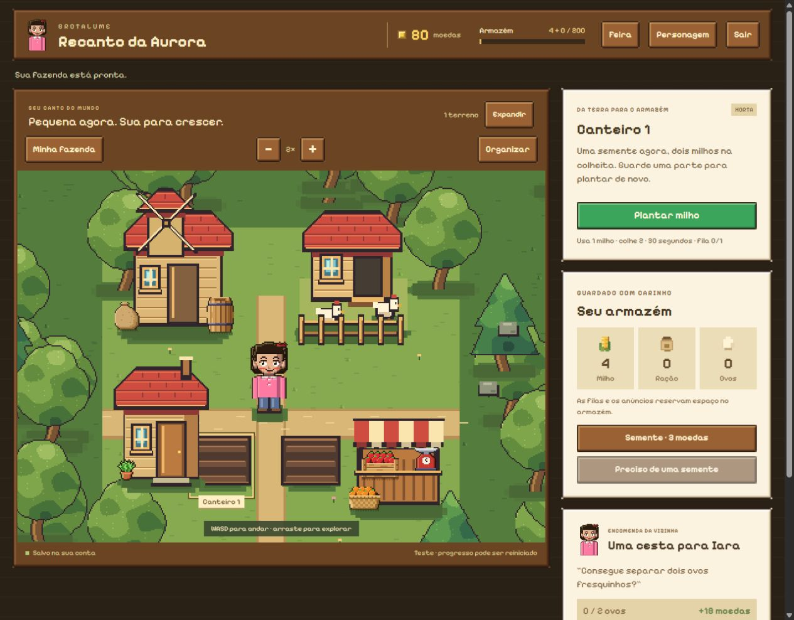

# QA — cenário e caminhada, 16/11/2026

Branch codex/fazenda-online-base, PR30. Protótipo visual integrado ao cliente /play/, ainda sem aprovação estética do Eric. O estudo01 isolado é histórico; esta rodada implementa movimento solicitado posteriormente. Nenhuma alteração de economia ou API de comandos.

## Entrega
- world-art.js separa aparência de estado: construções maiores que o footprint, âncora nos pés, contorno/paleta comuns, vegetação com silhuetas variadas e materiais mais distintos. Molduras, fontes, rostos e decoração originais reutilizados. Pernas CSS removidas; humano recebe corpo/pés em canvas, outras espécies preservam sua silhueta.
- WASD, câmera acompanhando e botões de 44×44 no telefone em pé. Movimento interrompido em diálogos, campos, organização, perda de foco e aba oculta. Ctrl/Meta/Alt não são capturados. Animação respeita movimento reduzido.
- Claude implementou o módulo puro de colisão e 11 testes. Codex implementou arte/input/câmera, integração e QA. [Relatório](CLAUDE_LOCOMOCAO_2026-11-16.md).

## Validação executada
- npm run verify: **55/55 PASS** local em PGlite, incluindo 11 testes puros de locomoção, preservação/relocalização, normalização diagonal, paredes, bordas e terrenos comprados. Tipos, sintaxe e build PASS. PostgreSQL real deve ser conferido na CI do commit desta entrega; PGlite não substitui concorrência real.
- Browser de QA em localhost:8864, banco separado da prévia principal 127.0.0.1:8860. Nenhuma conta QA criada na base principal.
- 20 toques reais em D: x5,600→7,441. W repetido parou nos pés y4,220 abaixo do galinheiro, sem atravessar; câmera acompanhou. Trocar para Iara preservou a posição durante a sessão; recarga preservou personagem e reiniciou posição local.
- Botão móvel direita: x5,600→5,690. Quatro botões medidos 44×44. D em campo de preço e durante organização não deslocou o avatar.
- Plantio: estoque4→3 com2 reservados; mover canteiro1 de(3,7) para(3,9) por campos salvou durante produção, recarga manteve posição/job. Conclusão produziu estoque5/reserva0. Anunciar1milho gerou4+1; cancelar restaurou5+0, moedas80 preservadas.
- Quatro viewports:393×760,1024×600,900×430,1280×680 sem overflow horizontal; larguras do documento378/1009/885/1265, respectivamente. Sprites em escalas inteiras1×/2×, sem suavização. Console sem erros/avisos capturados. Layout tem rolagem vertical intencional.
- Prévia principal reiniciada com build atualizado; entrada e módulos carregaram sem erro. Controle de viewport restaurado após QA.

## Limites
- Avatar ainda usa pose frontal e animação simples de passos. Folhas completas de frente/costas/lados são próxima tarefa visual; não declarar animação direcional pronta.
- Posição é local e reinicia ao recarregar; não há presença multiplayer nem sincronização de caminhada. Layout, personagem e inventário permanecem no servidor.
- Ajuste de ponto de pega do arraste foi implementado; nesta rodada o reposicionamento foi exercitado por campos, não por gesto de arraste. O QA anterior de arraste não comprova o gesto após esta alteração.
- iPhone/Safari físico, controle por toque sustentado em aparelho e desempenho em hardware fraco não foram medidos. Produção automática limitada permanece na fila funcional.
- Código/saves do Frutódromo publicado intactos; não repetido ciclo do caldeirão. Não há cache de service worker neste cliente Node, portanto não se alterou sw.js.

[Celular em pé](qa-caminhada-2026-11-16/fazenda-wasd-celular.jpg), [1280×680](qa-caminhada-2026-11-16/fazenda-wasd-1280x680.jpg), [900×430](qa-caminhada-2026-11-16/fazenda-wasd-900x430.jpg).
