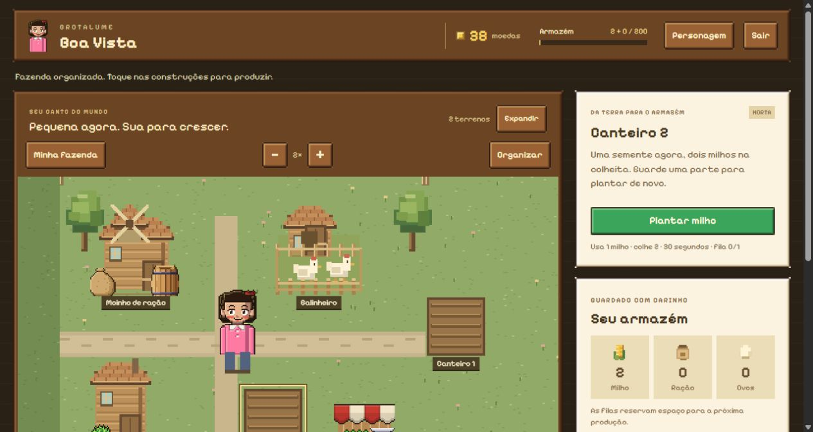

# Fazenda conectada e mapa — QA concluído em 16/11/2026

Branch `codex/fazenda-online-base`, [PR #30](https://github.com/Mendesoz/frutodromo/pull/30). Implementação8abb085, revisão23610f5 e guarda final de conta3d113ecb45435c83291198dd48c2d0e8910677a5. Entrada local: http://127.0.0.1:8860/play/ . Não é um backend hospedado publicamente.

## Entrega

- Cadastro/login e sessão na mesma origem do jogo, com fazenda carregada do servidor.
- Mapa contínuo com terreno inicial e compra de vizinhos, navegação por arraste/setas, zoom inteiro1/2/3, acesso à expansão também por botão fora do cenário.
- Dois canteiros, moinho e galinheiro; produção e filas exibidas no cliente, estoque e encomenda conectados ao servidor.
- “Organizar”: mover por arraste, toque de colocação ou coluna/linha. Servidor exige posse de toda a área ocupada, sem sobreposição com prédios/casa/banca.
- Personagem original escolhido entre22, layout e terrenos persistentes. Fontes, molduras, toldo, decoração e sprites reaproveitados; instalações/terreno em pixel art procedural. Nenhum caldeirão.
- Cliente nunca calcula saldo autoritativo nem importa saves locais. HTML/API no-store; arte e código estático com ETag/revalidação.

## Evidência automatizada

`npm run verify` e `npm run build`: **29 testes PASS** no Windows/Node22/PGlite, tipos e sintaxe do cliente incluídos. [CI43850499270](https://github.com/Mendesoz/frutodromo/actions/runs/43850499270), código3d113ec: **SUCCESS** em PostgreSQL17 real, tipos, testes, build, auditoria das dependências e sintaxe dos JS originais. A suíte inclui concorrência entre duas instâncias/pools.

Novos casos: migração de fazendas anteriores ao layout preservando moedas; cadastro com posições válidas; geometria meia-aberta/terrenos negativos; movimento válido e replay sem tocar em economia; prédio alheio, obstáculos, limites e chão não comprado recusados; duas construções disputando a mesma área; personagem e schema HTTP; lista fechada de arquivos estáticos, MIME/CSP, ETag304 e tentativa de ler .env/banco/código do servidor via URL recusada.

## Jogo real no navegador

Ambiente de QA separado:127.0.0.1:8861, banco `.data/map-qa`. Prévia original8855 não foi usada para modificar estado. As contas e valores abaixo são exclusivamente de QA.

1. Cadastro de Boa Vista com80moedas/4milhos. Dois plantios e produção de ração, aguardando o tempo real; duas alimentações e dois ovos. Entrega na UI:80→98moedas. Compra de terreno1,0 por60:98→38, total2terrenos.
2. Canteiro1 movido de3,7 para0,4 pelos campos. Tentativas de sobrepor a casa e ocupar12,4 antes de comprar o terreno: recusadas com aviso, posição/saldo preservados. Após comprar,12,4 aceito.
3. Personagem Iara escolhido, recarga e reinício do servidor de QA preservaram personagem,2terrenos,38moedas e posição12,4.
4. Navegação por arraste do fundo: deslocamento50px observado. Setas direita/esquerda retornaram à mesma transformação.
5. Após impedir seleção de texto no arraste, Canteiro2 movido por arraste real6,7→4,7; confirmação e campos4/7 na UI. “Escolher lugar no mapa” + clique no cenário moveu4,7→6,7, confirmação e campos6/7. Não é simulação de comando por JavaScript.
6. Expansão adicional com saldo38/custo120: botão desabilitado e aviso de82moedas faltantes. Não houve débito.

## Falhas controladas e troca de conta

Proxy de QA temporário em localhost:8862, fora do aplicativo/rotas de produção, encaminha à API de QA e pode devolver504 **depois** de o backend ter confirmado a ação. Os controles de falha não foram adicionados ao servidor do jogo.

- Compra na contaA:77→74moedas/5→6milhos no servidor, cliente recebeu504 e exibiu “Tentar novamente”. O poll continuou: saldo74 e6milhos apareceram mesmo com pedido pendente. Reenvio pela UI manteve74/6 e liberou controles — efeito único.
- Nova compra com resposta incerta, seguida de401 simulado na consulta: retorno à entrada descartou o pedido. ContaB cadastrada pela UI entrou com80moedas/4milhos e botão de reenvio oculto. Nenhuma ação da contaA executou naB.
- O cliente vincula o pedido à fazenda também antes de reenviar, rejeita resposta de geração anterior e aguarda consulta nova após confirmar uma mutação.
- Reforço final, exercitado por HTTP automatizado local/CI: pedido com cookie da contaB e `X-Farm-Id` da fazendaA retorna409/FARM_CHANGED. Ambas mantêm80moedas e nenhuma operação é gravada. O mesmo comando, explicitamente paraB, é aceito e debita apenasB para77. A checagem fica sob a trava da fazenda no servidor, cobrindo mudança de cookie depois da verificação local. O cliente trata a divergência sincronizando novamente. Não foi necessário alterar o visual das capturas para esse reforço.

## Dimensões e imagens

| Tela | Rolagem horizontal | Escala do canvas |
|---|---|---|
|393×760|nenhuma|1×|
|1024×600|nenhuma|1×|
|900×430|nenhuma|1×|
|1280×680|nenhuma|2×|

Página pode rolar verticalmente. Mapa pode ser arrastado para explorar. Capturas finais são de viewport; capturas full-page foram substituídas porque a captura temporariamente alterava o enquadramento do mapa. Console final da fazenda sem erros/avisos capturados.504/401 do proxy são falhas intencionais, não incluídas como console limpo.

[Celular](qa-2026-11-16/celular.jpg). As quatro capturas completas de viewport permanecem também na pasta local outputs/fazenda-online/.

## Participação do Claude e limites

Claude implementou, nos arquivos combinados, geometria/layout, migração003, comandos move/customize e9testes; Codex integrou e executou. [Relatório](CLAUDE_LAYOUT_2026-11-15.md). Claude fez [revisão do cliente](CLAUDE_CLIENTE_2026-11-15.md) e [verificação final](CLAUDE_CLIENTE_FINAL_2026-11-16.md), somente leitura, sem executar testes. Codex corrigiu os casos pertinentes: pedido pendente entre contas, fallback de chave, sincronização durante falha, profundidade dos objetos, obstáculos do snapshot, zoom sem redesenhar terreno, arraste sem selecionar texto, guarda por ponteiro primário e desbloqueio imediato ao descartar pedido.

Guarda multitoque e fallback sem randomUUID conferidos por leitura/sintaxe; não afirmar teste em Safari/iPhone físico. Nenhum mercado entre jogadores, pagamento ou hospedagem pública entregue. QA não mede retenção, balanceamento ou carga de produção. Há uma única cultura/cadeia e layout inicial pequeno, não um Hay Day completo. Saves/arte/build publicados do Frutódromo não foram alterados; diff dos arquivos originais vazio.

Próxima etapa: comércio virtual com lotes reservados, compra/cancelamento atômicos e teste entre duas contas.
