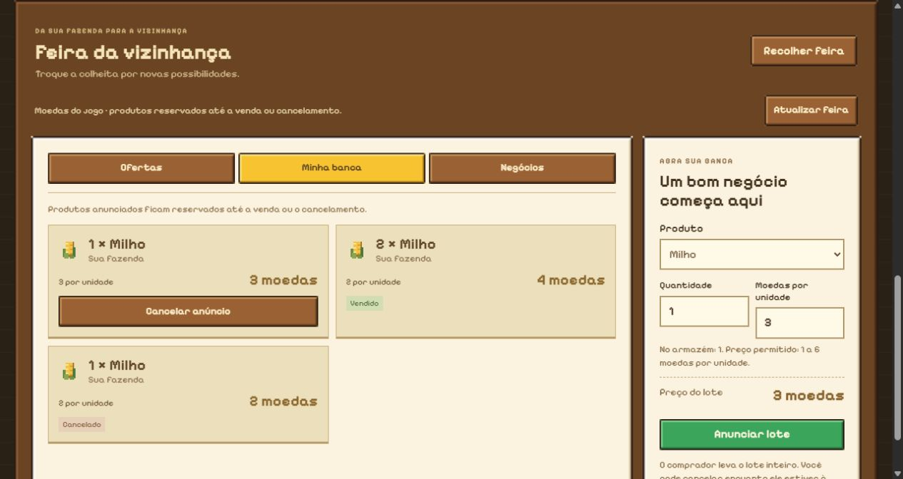
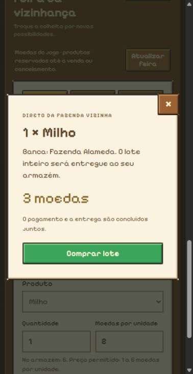

# Feira virtual — QA de 16/11/2026

## Entrega e limite

Etapa3 do plano de novembro, branch `codex/fazenda-online-base`, implementação `4f4b6cf7f96fbe7bd8c7e43d3734455b3ff4f42b`, cobertura `8aedd7c6d8ec358d7c55a68b2e09d762e9ba1daa`, código final `a0622d8d7f1973ff9b1a094ae91134050041ede7`, [PR30](https://github.com/Mendesoz/frutodromo/pull/30). Piloto virtual resetável: anunciar milho/ração/ovo, comprar lote inteiro, cancelar anúncio próprio, consultar histórico. Sem comissão, compra parcial, pagamento ou saque. Não é teste público nem publicação na main.

Claude implementou `market.ts`, migração004 e13testes em arquivos previamente reservados. Codex extraiu os helpers econômicos compartilhados, integrou API e cliente, adicionou testes HTTP/resgate, executou testes/QA e recebeu uma revisão independente somente leitura. [Entrega recebida](CLAUDE_MERCADO_IMPLEMENTACAO_2026-11-16.md) e [revisão final](CLAUDE_REVISAO_MERCADO_2026-11-16.md). O processo CLI não opera o desktop nem injeta mensagens no chat antigo.

## Verificações executadas

- `npm run verify`: **43/43 PASS** em PGlite local; adicionado depois o caso de resgate com lote reservado, com os2testes de market-http passando localmente. Tipos e sintaxe dos três módulos web passaram novamente.
- **44/44 PASS no PostgreSQL17 real**, CI final [43856745064](https://github.com/Mendesoz/frutodromo/actions/runs/43856745064), códigoa0622d8; execução adicional43856751215 também verde. Verify/build/auditoria de dependências/sintaxe passaram. CI anterior43855795937 tinha44testes em8aedd7c; inicial43855145392 tinha43testes em4f4b6cf.
- Cobertura nova: reserva/devolução, conservação de saldos/itens/eventos, replay, divergência de payload, limites de item/preço/lote, saldo/capacidade, erro com rollback, resgate/produção contra estoque reservado, dono da banca, fazenda esperada, duas pools disputando um lote, cancelamento contra compra, compras recíprocas sem deadlock e vitrine sem credenciais/saldo alheio.
- Teste HTTP: vitrine exige sessão; total e vendedor forjados no corpo são rejeitados; mudança da fazenda esperada não cobra nada; replay da compra devolve o mesmo recibo e um único débito/crédito.
- `npm run build`, `node --check js/game.js`, `node --check js/i18n.js`, `git diff --check`: PASS. Main permanece ancestral do trabalho compartilhado; não houve rebase/force ou merge de publicação.

## Jogo no navegador

QA isolado em `http://localhost:8863/play/`, banco `.data/market-qa`, sem usar a sessão do usuário em127.0.0.1. Cookies não separam portas: o hostname distinto é necessário para não substituir o acesso da prévia principal.

1. Conta vendedora Fazenda Alameda começou com80moedas/4milhos. Anunciou1milho, cancelou e recebeu o produto de volta. Depois anunciou2milhos×2moedas: estoque2, reserva2, ocupação4.
2. Conta compradora Fazenda Lagoa começou com80moedas/4milhos. Abriu oferta e confirmou4moedas. Terminou76moedas/6milhos; histórico de compra−4. Vendedora terminou84moedas/2milhos; histórico+4.
3. Recarregar a vendedora preservou saldo, estoque e histórico. Anúncio vendido e cancelado continuaram visíveis, sem botão de cancelar.
4. Nova oferta1milho×3moedas; troca explícita para compradora limpou dados e voltou à aba Ofertas. No viewport393×760, diálogo mostrou produto/lote/banca/total, compra confirmou e compradora terminou73moedas/7milhos. Histórico mostrou as duas compras. Na rodada final, novo login na vendedora confirmou87moedas/1milho.
5. As quatro dimensões393×760,1024×600,900×430,1280×680 não tiveram overflow horizontal. Feira empilha cards/formulário em tela estreita. Capturas de viewport, sem captura fullPage que altera temporariamente o tamanho.
6. Console do tab de QA: nenhum aviso/erro capturado na passagem inicial. Na rodada de falha houve409 intencional de saldo insuficiente, descrito abaixo. Prévia principal reiniciada no compilado novo: health200, market.js200, entrada aberta/recarregada sem erro de console; nenhuma conta de QA criada no banco principal nesta etapa.

Evidências:

[Feira393×760](qa-mercado-2026-11-16/feira-393x760.jpg), [1024×600](qa-mercado-2026-11-16/feira-1024x600.jpg), [900×430](qa-mercado-2026-11-16/feira-900x430.jpg), [histórico comprador](qa-mercado-2026-11-16/negocios-compra-393x760.jpg).

## Pendências preservadas

- Preços e limites são candidatos; nenhuma medição de retenção, procura real, renda ou equilíbrio.
- Cadastro inicial e resgate ainda permitem exploração por multicontas; impedir resgate enquanto há lote ativo fecha apenas um caminho direto. Não há prontidão antifraude/economia pública.
- Saldo máximo2bilhões pode recusar crédito do vendedor usando o erro genérico INSUFFICIENT_COINS; transação inteira reverte. Melhorar mensagem antes de escalar, sem risco de débito parcial.
- Histórico/vitrine têm limites60ofertas/30próprios/20negócios; sem paginação. GET da vitrine usa read committed e pode mostrar estado transitório; comando sempre revalida sob trava.
- Replay valida formato/preço antes de consultar recibo; mudança futura de regras exige preservar replay de comandos antigos. Nenhuma alteração de preços nesta entrega.
- Sem teste em iPhone/Safari físico, rede externa ou carga. Quatro viewports não equivalem a testes de aparelho real. Backup/restauração e hospedagem permanecem etapa5.
- Código original, saves e build CrazyGames não foram alterados; não se repetiu o ciclo do caldeirão porque os arquivos do lançamento ficaram intactos. Sem alteração do service worker, pois o cliente Node tem entrada própria e respostas revalidadas/no-store.

## Tratamento da revisão final

Claude não encontrou bloqueador nas transações por leitura. Sua ressalva sobre concorrência em PGlite foi satisfeita pelos44testes no PostgreSQL real. Codex aplicou dois achados no código `a0622d8`:

- M3: erro de compra agora aparece dentro do diálogo; recusa definitiva atualiza também `/api/farm`, e o botão permanece bloqueado até fechar/reabrir. Erro de resposta incerta orienta fechar e reenviar a mesma chave pelo controle existente. Troca de conta não recebe mensagem velha.
- B3: schema HTTP calcula o teto geral a partir das regras do módulo, evitando duplicar o número30.

Regressão dirigida real de M3: vendedora anunciou1milho por6; compradora abriu confirmação com saldo suficiente. Outra aba da mesma conta comprou terreno60 e3sementes×3, reduzindo73→4moedas. Confirmar a oferta na primeira aba recebeu409, mostrou “Ainda faltam moedas para essa compra.” dentro do diálogo e desabilitou Comprar lote. Ao fechar, saldo atualizado4 e estoque10; lote continuou na feira, sem débito/entrega indevidos. [Captura do erro](qa-mercado-2026-11-16/erro-compra-1280x680.jpg). Tipos/build e os2testes dirigidos HTTP/resgate passaram de novo após o ajuste.

M1 (brindes concentráveis por multicontas) e M2 (vitrine limitada/monopolizável) aceitos **somente no piloto fechado resetável**, registrados para bloquear economia pública; não acrescentar prazo/carência/taxa sem modelar o efeito no loop. B1/B2/B4–B7 ficam no backlog: replay ao mudar regras, mensagem de teto de saldo, canonicalização de arrays/UUID, consultas redundantes, paginação/índices e expiração opcional de anúncios. Anúncio ativo não expira automaticamente nesta versão; cancelamento próprio devolve os produtos.

Próxima tarefa: etapa4, reposição com limite explícito de ciclos/tempo/ingrediente, conservação e equivalência online/offline. Ler o plano/centralizador antes de reservar arquivos.

## Coordenação com a frente de VIP

Durante o QA, foram encontrados303bbb6 (documento) e e65e26d (protótipo local de ficha VIP/comissão10%) nas branches do Claude. O experimento altera somente o protótipo separado; não foi incorporado ao servidor nem confundido com mercado autoritativo. Mensagem pelo comando oficial `claude -p --cloud` à sessão identificada nos commits retornou `ok:true`: entregou estado/PR/CI/limites e pediu coordenação antes de editar server/. **Confirmação posterior:** commit41ef83e do Claude registrou no README do protótipo o handoff e a separação da feira online/experimento VIP. Isso comprova alinhamento recebido nessa frente, sem sincronizar todos os históricos. Nova proposta precisa ser avaliada separadamente, sem reintroduzir o caldeirão.
