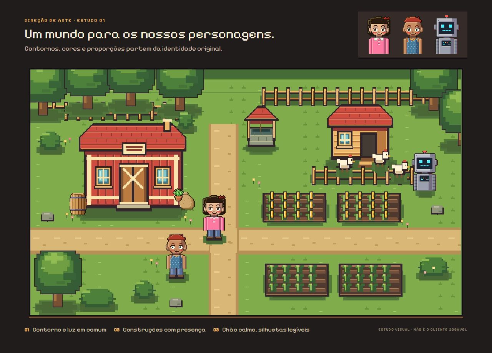

# Estudo01 — congruência do cenário

Proposta visual isolada de16/11/2026. Contexto, critérios e estado de aprovação em [DIRECAO_ARTE.md](../DIRECAO_ARTE.md).

Na raiz do repositório: `node docs/online/estudo-visual/serve.mjs`. Abrir `http://127.0.0.1:8870/`. Servidor de leitura em loopback, lista fechada de seis recursos, sem rotas de conta/estado ou acesso genérico a diretórios. Não é hospedagem pública.

- Canvas560×320 nativo, exibido1120×640 (2×). Elenco40×50 exibido80×100 (2×), sem suavização.
- Escala fixa dentro de janela com rolagem no telefone. Isso é uma prancha de estudo, **não** a câmera responsiva do jogo final.
- Personagens originais em `prototipo-fazenda/sprites.js`; molduras/fontes e decoração preservadas. Nenhum asset externo ou gerador de imagem.
- Não altera banco/API/cliente, footprint, save ou receitas. O celeiro é amostra de linguagem, não instalação nova implementada.
- Humanos reutilizam rosto/torso com estudo de pernas/pés em canvas. Folha de corpo/direções definitiva e animações ainda pendentes. Outras espécies exigem anatomia própria.

Verificações desta rodada: sintaxe de `study.js`/`serve.mjs`; carregamento da página/arte; captura e inspeção visual em navegador. Viewports e evidência final no registro abaixo, sem alegação de teste em iPhone físico. Não repetir testes econômicos só por causa de uma prancha documental.

## Resultado de16/11

Prancha inspecionada em1280×920. Em393×760,1024×600,900×430 e1280×680: página sem overflow horizontal, janela do desenho com rolagem própria; cena e os3exemplos de elenco em2×inteiro, fonte/arte carregadas e sem avisos/erros capturados no console. Os arquivos da cena passaram em `node --check`; `js/game.js`, `js/i18n.js` e `git diff --check` também passaram. Nenhuma interação produtiva ou regressão econômica nova nesta entrega.

